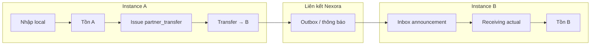

# Kịch bản hàng hoá giữa 2 DN (A ↔ B)

Tài liệu thao tác / kỳ vọng tồn kho khi **hai doanh nghiệp cùng dùng Nexora**.  
Topology & login: [`two-enterprise-ab.md`](./two-enterprise-ab.md).  
Model Partner (supplier/customer theo chiều chứng từ): [`BRD-partner-link.md`](../../documents/requirements/BRD-partner-link.md).

## Vai trò trên mỗi chiều hàng

| Chiều | Nhà cung cấp (xuất) | Bên nhận | Chứng từ chính |
| --- | --- | --- | --- |
| A → B | A | B | Issue `partner_transfer` + Transfer (A) → Receiving (B) |
| B → A | B | A | Đảo chiều |
| Nội bộ A hoặc B | — | — | Inbound local, đơn hàng/POS, issue `sale` — **không** federation |

## Điều kiện trước khi chạy G* (hàng liên DN)

1. A và B ERP lên (`19080` / `19081`), login được (admin hoặc staff đã fix MFA local).
2. Mỗi bên có: kho active, sản phẩm+biến thể, lô `available`, **tồn > 0** (nhập local trước).
3. Liên kết đối tác **hai chiều** active (`/partners`).
4. Worker + Flowable BPMN đã deploy trên cả hai (issue `partner_transfer` mới duyệt được).
5. (Tự động) Fixture + federation: `seed-abc` + `configure-abc-federation` với project `nexora-a` / `nexora-b`.



---

## G0 — Baseline độc lập (mỗi DN)

**Mục tiêu:** Chứng minh catalog/tồn/đơn hàng **không** lẫn nhau.

| Bước | UI / API | Kỳ vọng |
| --- | --- | --- |
| G0.1 | A + B: `/products` tạo SKU khác nhau | SKU A không có trên B |
| G0.2 | `/inventory/warehouses` | Mã kho riêng (vd `WH-A` / `WH-B`) |
| G0.3 | `/trading/inbound` → nguồn **local** → confirm | Tồn tăng **chỉ** instance đó |
| G0.4 | `/orders` hoặc `/pos` bán 1 đơn | Trừ tồn local; không có outbox federation |
| G0.5 | So sánh `/inventory/balances` hai bên | Số liệu độc lập |

**PASS:** Sau G0, A và B đều có tồn local; không chứng từ A trên list B.

---

## G1 — Kết nối đối tác (một lần)

| Bước | A | B |
| --- | --- | --- |
| G1.1 | `/partners` → Thêm đối tác `nexora-b` | Thêm `nexora-a` |
| G1.2 | Thiết lập liên kết (địa chỉ gateway B + ủy quyền) | Đảo chiều |
| G1.3 | Kiểm tra liên kết | Kiểm tra liên kết |

**PASS:** Cột liên kết = Đã kết nối hai bên. (Chi tiết secret/M2M: federation overlay trong `two-enterprise-ab.md`.)

---

## G2 — Chuyển hàng đầy đủ A → B (happy path)

**Số liệu mẫu** (đổi được; ghi lại trước khi chạy):

| Thời điểm | Tồn A | Tồn B |
| --- | --- | --- |
| Trước G2 | `Qa` (vd 20) | `Qb` (vd 0) |
| Sau issue confirm (xuất 12) | `Qa - 12` | `Qb` |
| Sau transfer confirm | Không đổi thêm | Không đổi (chỉ thông báo) |
| Sau receiving B actual=10 | Không đổi | `Qb + 10` |
| Sau business receipt về A | Delivery `partial` nếu 10&lt;12 | — |

### Thao tác A (nhà cung cấp trên chiều này)

1. Đảm bảo lô `available`; tồn ≥ 12 — `/inventory/balances`.
2. `/trading/issues` → tạo phiếu xuất, purpose **`partner_transfer`**, qty **12** → Submit.
3. `/trading/approvals` (user approver) → Duyệt.
4. Quay lại issue → **Confirm** → tồn A −12.
5. `/trading/transfers` → tạo transfer gắn issue vừa confirm, **Đối tác nhận = B** → Confirm.  
   - Không trừ tồn lần 2.  
   - Worker đẩy thông báo sang B.

### Thao tác B (bên nhận)

1. `/trading/inbound` (lọc Nexora) hoặc `/trading/receivings` — thấy announcement từ A.
2. Tạo receiving: map **lô local B**, kho B, **actual = 10** (hoặc = sent nếu muốn `received` đủ).
3. Confirm → tồn B +actual.
4. (Tuỳ) đánh dấu lô nhận `available` nếu còn `inspect`.

### Kiểm A sau nhận

1. Mở transfer A → `delivery_state` = `received` hoặc `partial`.
2. Có business receipt (actual khớp).
3. `/partners` theo dõi: không dead-letter cho message đó.

**PASS checklist G2**

- [ ] Tồn A giảm đúng qty issue (không giảm thêm khi transfer).
- [ ] Tồn B tăng đúng **actual** receiving.
- [ ] ACK kỹ thuật ≠ cộng tồn B (chỉ receiving confirm mới cộng).
- [ ] UI A ghi Đối tác nhận = B; không nhãn “NCC cố định” trên master Partner.

---

## G3 — Chiều ngược B → A

Lặp G2 với B xuất (`partner_transfer`), A nhận.

**PASS:** Cùng Partner; trên chiều này B = nhà cung cấp, A = bên nhận. Tồn B giảm / A tăng đúng actual.

---

## G4 — Partial / dispute nhận thiếu

1. A xuất & transfer **qty = 8**.
2. B receiving **actual = 5** + lý do lệch.
3. A: delivery `partial`; discrepancy_reason có mặt.
4. **Không** sửa tồn A bằng tay / SQL để “bù” thiếu.

**PASS:** Sent 8, actual 5, tồn B +5; A vẫn  giữ sau-issue; business receipt phản ánh lệch.

---

## G5 — Hàng liên DN rồi bán nội bộ phía nhận

1. Hoàn G2 (B có tồn từ A).
2. B: `/orders` hoặc `/pos` (hoặc issue `sale` + sales-record) bán một phần tồn nhận được.
3. A: tồn **không** đổi khi B bán.

**PASS:** Chuỗi truy xuất phía B có nguồn partner; bán local không phát federation ngược trừ khi có luồng impact riêng (P09 trace — ngoài MVP UI này).

---

## G6 — Đơn hàng nội bộ song song (không lẫn chuyển hàng)

| DN | Việc | Không làm |
| --- | --- | --- |
| A | POS/orders trên tồn local A | Không chọn Partner như “khách CRM” thay cho bán lẻ |
| B | POS/orders trên tồn local B | Không dùng issue `partner_transfer` cho bán tại quầy |

**PASS:** Hai đơn độc lập; không outbox `transfer.announced` khi chỉ checkout.

---

## G7 — Lỗi & cô lập

| Case | Cách tạo | Kỳ vọng |
| --- | --- | --- |
| B tắt khi A transfer | `docker compose … -p nexora-b stop gateway worker` | A vẫn confirm transfer; outbox retry/dead-letter; A bán nội bộ vẫn OK |
| Mapping gap | Receiving thiếu lô local | Inbox pending_dependency; `/partners` → Xử lý lại sau khi bind/tạo lô |
| Sai purpose | Issue `sale` rồi cố gắn transfer | API/UI từ chối — transfer chỉ link issue `partner_transfer` |

---

## G8 — Script tự động (khi fixture sẵn)

```powershell
$env:DEMO_ONLY = "true"
# Cần seed-abc a+b, federation A↔B, Flowable BPMN, project nexora-a|b
node deploy/scripts/journey-ab-goods.mjs
```

Script thực hiện: mở tồn A (receipt nếu 0) → issue+transfer A→B → receiving B (có thể partial) → optional B→A rút gọn → in balances PASS/FAIL.  
Journey đầy đủ A→B→C vẫn dùng `journey-p09-core.mjs`.

---

## Bảng tóm tắt số liệu mẫu (in ra khi PASS)

| Bước | A | B |
| --- | --- | --- |
| Opening | 20 | 0 |
| Sau issue A 12 | 8 | 0 |
| Sau receive B actual 10 | 8 | 10 |
| Sau issue B→A 4 (optional) | 8+4 | 6 |
| Sau bán B local 2 | 12 | 4 |

Điều chỉnh số theo tồn thực tế; **ghi baseline trước mỗi run**.

---

## Ma trận nhanh (copy checklist)

- [ ] **G0** Catalog/tồn/đơn độc lập  
- [ ] **G1** Partner link 2 chiều  
- [ ] **G2** A→B full + business receipt  
- [ ] **G3** B→A  
- [ ] **G4** Partial receive  
- [ ] **G5** B bán sau khi nhận  
- [ ] **G6** Orders/POS không federation  
- [ ] **G7** Offline / mapping / sai purpose  
