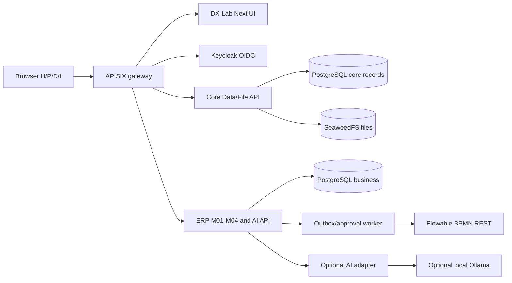

# P11-T01 — DX-Lab runtime and service boundary

Date: 2026-11-27. Branch: `phase-11`. Base: `phase-10` at `6490adc`. This records the separate tier-2 runtime, the intended real API routes and the headless verification. The unapproved G10 sign-off remains open; this document does not certify G11.

## Runtime and service call map

`apps/dx-lab/` is one Next.js 16 application with four planned H/P/D/I areas and a `/dxlab` base path. APISIX routes `/dxlab*` to the DX-Lab process, `/api/v1/core/*` and `/api/v1/files*` to Core Data/File, and the remaining `/api/v1/*` to ERP. Each A/B/C Compose project has its own processes and database. The DX-Lab container has only public/identity configuration and no database URL, S3 key, Flowable credential, or direct Admin API route. The initial page is a runtime placeholder; H/P/D/I journeys are T02–T07, not claimed here.

| Area / destination | Gateway API used by workspace | Owning runtime and data |
| --- | --- | --- |
| H `/work`, `/profile`, `/members`, `/partners` | `/api/v1/me`, `/api/v1/organization`, `/api/v1/members*`, `/api/v1/partners*`, `/api/v1/approvals/inbox`, `/api/v1/files*` | ERP M01 and approval bridge; Core File API for authorized clean files |
| P `/operations/{receipts,issues,transfers,receivings}`, `/work/approvals` | `/api/v1/products`, `/api/v1/batches`, `/api/v1/warehouses`, `/api/v1/inventory/balances`, `/api/v1/{receipts,issues,transfers,receivings}*`, `/api/v1/approvals/{id}/decisions` | ERP M02/M03 transactions; worker talks to Flowable internally |
| D `/data/inventory`, `/data/lots/[id]`, `/data/impact/[id]` | `/api/v1/inventory/balances`, `/api/v1/inventory/movements`, `/api/v1/lots/{id}/trace/{backward,forward}`, `/api/v1/core/records`, `/api/v1/files/{id}` | ERP inventory/trace plus Core records and evidence files |
| I `/assistant` | `/api/v1/ai/chat`, `/api/v1/ai/draft`, `/api/v1/ai/draft/create`, then ordinary M03 Draft actions | ERP actor-scoped AI orchestration; optional private AI adapter and Ollama; no model authority to confirm |
| Public `/passport/[token]` | `/api/v1/public/passport/{token}`, `/api/v1/public/evidence/{id}` | ERP public policy projection and Core public evidence allowlist |

The browser talks to the gateway. Keycloak provides authentication. The DX-Lab server will keep a private OIDC session and call gateway APIs with the user's access token; ERP and Core repeat authorization. The workspace never queries a DB or calls Flowable's admin REST. Stopping both DX-Lab and ERP UI also stops ERP business APIs in the current monolith; the headless test must therefore use only SSO, gateway, Core Data/File and Flowable endpoints, never M01–M04 routes.

## Verification — observed on instance A

- `npm run build:dxlab` passed as a separate Next build; `docker build -t nexora-dx-lab:p11-t01 -f apps/dx-lab/Dockerfile .` passed. A temporary container returned 200 on `/dxlab` and `/dxlab/api/health`, then was removed.
- Instance A DX-Lab Compose container served `GET /dxlab` and `GET /dxlab/api/health` through APISIX with HTTP 200. It was then stopped. The gateway route forwards the base path without rewrite, so static assets and later OIDC callback stay on the separate runtime.
- `node deploy/scripts/smoke-core.mjs a --assert-ui-stopped` passed with ERP, DX-Lab and worker stopped. The stopped-UI assertion passed; gateway ping, SSO discovery/token, Flowable management, Core readiness, unauthenticated 401 checks, clean file upload/scan/download, member lookup, record create/get and service-only 403 all passed. The smoke created one small test file and record in A. It used the Keycloak private backchannel from the Core container while preserving the browser issuer for token validation.
- `deploy/compose.yml` exposes no `DATABASE_URL`, S3 or Flowable credential to DX-Lab; its only configured environment at T01 is `PUBLIC_BASE_URL` and `OIDC_ISSUER_URL`. Business API and Core still recheck authorization. G10 team/advisor sign-off remains pending and G11 UX evidence is not claimed.
