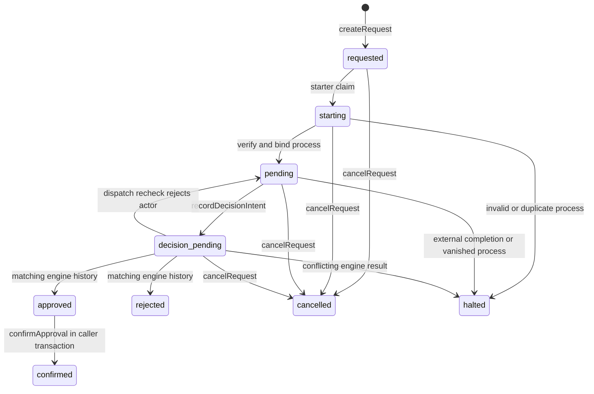

# Approval bridge contract v1 — P04-T06

## Boundary

The bridge stores local approval requests, dispatches intents through Flowable, and projects proven history into local state. There is no UI, Keycloak-to-Flowable identity sync, real warehouse scope data, stock movement, or webhook. Unauthenticated callbacks are never trusted. GoodsIssue integration follows in the module phase.

**Your module never calls Flowable; write approval requests and read local approval state.**

## Request

Call `createRequest(tx, {documentId, submittedDocumentVersion, creatorSub, warehouseIds, lineSnapshotSha256})` inside the document submission transaction. `creatorSub` comes from authenticated membership, never the request body. Compute the hash from immutable submitted lines using `computeLineSnapshotSha256`. One `documentId` has one approval request for its lifetime, including cancellation/rejection. Resubmission requires a **new document ID**. The local approval UUID is the engine businessKey. One process key is supported: `goods-issue-approval`, bound to the latest deployed definition at start time; the actual definition ID/version are retained.

## Decision

Call `recordDecisionIntent(tx, resolver, {approvalRequestId, actorSub, decision, reason, flowableTaskId, expectedVersion})`. The resolver reads *current* membership and scope at call time. In order: active approver; actor not creator (403); complete warehouse set (403); pending state; expected approval version (409); nonblank rejection reason (422 in the future HTTP adapter). Success records an intent, audit, and one outbox row in the same transaction; the future HTTP adapter returns 202. Same actor/decision/task/reason while pending replays the row. Conflicting pending decision returns 409. The HTTP pipeline's same Idempotency-Key with different body returns `IDEMPOTENCY_CONFLICT`. The worker rechecks current authorization before engine completion; candidate group is routing only.

| State | Entered when | Left by | Document shows |
| --- | --- | --- | --- |
| `requested` | Submission transaction commits | Starter | Pending approval |
| `starting` | Starter claims delivery | Starter/reconciler or cancel | Pending approval |
| `pending` | Process binding saved or authorization revoked | Decision, cancel, reconciler | Pending approval |
| `decision_pending` | Decision intent committed | Reconciler, revocation, cancel | Pending approval |
| `approved` | Matching history synced | Confirm gate | Approved, not issued |
| `rejected` | Matching history synced | Never; clone document | Rejected |
| `confirmed` | Confirm gate commits with caller effect | Never | Confirmed |
| `cancelled` | Cancel tombstone commits | Never | Cancelled |
| `halted` | Binding/history ambiguity detected | Operator tooling (T07) | Blocked |

| Event | Meaning | Producer | Consumer |
| --- | --- | --- | --- |
| `workflow.approval.requested.v1` | Start a process for this approval | Submit path | Starter |
| `workflow.approval.decision_requested.v1` | Human decided; tell engine | Decision path | Decider |

`started`, `approved`, `rejected` lifecycle schemas are reserved; no lifecycle events are emitted before a real consumer exists. T04's two fixed outbox destinations are amended by one internal destination, `workflow`.

## Failures and confirmation

The dispatcher retries transient engine failures up to eight attempts. A dead-lettered decision stays `decision_pending` until T07 admin retry; never infer a decision from elapsed time. A revoked approver before dispatch resets intent and returns to `pending`. History that cannot prove the stored decision, actor, and timestamp nonce halts the request. Cancellation prevents confirmation; cleanup deletes a still-running engine process. An engine failure never grants approval.

Call `confirmApproval(tx, resolver, reconcileApprovalBound, {approvalRequestId, actorSub, currentLineSnapshotSha256})` before writing the document's stock effect within the **same caller transaction**. Reconcile-on-read first syncs engine history. The gate locks the row, checks the confirming actor's current active warehouse scope, requires local `approved`, compares a newly computed current line hash to the approved hash, then CAS-confirms. The module checks `If-Match` against the **current** document version; do not compare against submitted document version. Transaction rollback reverts both confirmation and module effect.

Never call Flowable REST, complete a task, write approval rows directly, poll the engine from a module, or assume Flowable businessKey uniqueness. No module may emit approval lifecycle events before registering a consumer.

## Worked timeline and proof

| Time | Local approval | Engine | Actor |
| --- | --- | --- | --- |
| 00:00 | `requested` | absent | submitter |
| 00:01 | `starting` then `pending` | one process, one task | starter |
| 00:02 | `decision_pending` | task open | approver |
| 00:03 | `decision_pending` | task completed | decider |
| 00:04 | `approved` | matching history | reconciler |
| 00:05 | `confirmed` | ended | authorized confirmer |

Run `npm test` and `npm run typecheck` for local checks. Run `npm run test:platform:workflow-bridge` for live engine/database coverage when a Docker stack is available. HTTP routes, real warehouse-scope source, Inventory port, and lifecycle-event emission remain module-phase work.
