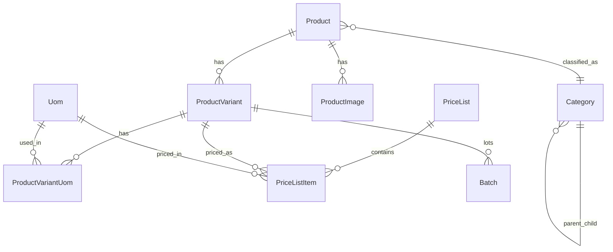

<!-- SPDX-License-Identifier: AGPL-3.0-only -->
# SRS — Product catalog (upgrade)

**Status:** Requirements accepted (documentation) — **2026-11-22**  
**Companion BRD:** [`BRD-product-catalog.md`](./BRD-product-catalog.md)  
**UI surfaces:** extends [`SRS-UI-surfaces.md`](./SRS-UI-surfaces.md)  
**Gate before code:** [ADR 0017](../adr/0017-catalog-variant-uom-price.md) + Dev-approved [`evidence/p065-schema-design.md`](../phase-plan/evidence/p065-schema-design.md) (affects `catalog` + inventory FK to variant)

## 1. Scope

Định nghĩa yêu cầu hệ thống cho mô hình catalog đích: product / product_variant / category / uom / product_variant_uom / price_list / price_list_item / product_image; search; soft-delete; biên costing. **Không** gồm DDL Prisma trong tài liệu này.

## 2. Logical data model



### 2.1 `catalog.category`

| Field | Rule |
| --- | --- |
| id | UUID PK |
| code | unique, immutable after create recommended |
| name | required |
| name_normalized | backend-maintained |
| parent_id | nullable self-FK; root = NULL |
| sort_order | int |
| is_active | boolean NOT NULL DEFAULT true |
| deleted_at | soft delete |
| version | optimistic |

**Invariants:** no self-parent; no cycles; depth ≤ 8; delete/deactivate blocked if active children or products reference node.

**Filter:** products in category C = products whose `category_id` is C or any descendant of C (recursive CTE or closure table — ADR chooses).

### 2.2 `catalog.product`

| Field | Rule |
| --- | --- |
| id | UUID PK |
| name | required |
| search_text | backend-maintained normalized search corpus |
| attributes | JSONB — description, origin, brand, extensible keys |
| category_id | FK category NOT NULL (v1) |
| is_active | boolean NOT NULL DEFAULT true |
| deleted_at | soft delete |
| version | optimistic |

**Forbidden on product:** `sku`, `barcode`, `base_unit` (P06 columns superseded in target model).

### 2.3 `catalog.product_variant`

| Field | Rule |
| --- | --- |
| id | UUID PK |
| product_id | FK product |
| sku | nullable text |
| barcode | nullable text |
| is_primary | boolean |
| is_active | boolean NOT NULL DEFAULT true |
| deleted_at | soft delete |
| version | optimistic |

**CHECK:** `sku IS NOT NULL OR barcode IS NOT NULL`.

**Mutability:** PATCH may change `sku` and/or `barcode` (audit + If-Match).

**Uniqueness (instance-wide, including soft-deleted rows):**

1. Non-null `sku` unique among all variants’ `sku`.
2. Non-null `barcode` unique among all variants’ `barcode`.
3. Cross-field: a value used as `sku` on variant A must not appear as `barcode` on variant B ≠ A (and vice versa).
4. **Exception:** on the **same** variant, `sku = barcode` is allowed.

**Primary:** at most one row with `is_primary = true` AND `deleted_at IS NULL` AND `is_active = true` per `product_id`. Creating first variant sets primary if none exists.

### 2.4 `catalog.product_image`

1–n on product: `product_id`, `attachment_id` (or file id), `sort_order`, `is_primary`, soft-delete. No embedded BLOBs. Optional `variant_id` deferred (v1 null).

### 2.5 `catalog.uom`

| Field | Rule |
| --- | --- |
| id | UUID PK |
| code | stable machine key (from normalize); unique |
| name | canonical display (e.g. `CÁI`) |
| name_key | accent-stripped upper unique key |
| kind | count \| mass \| volume (extensible) |
| is_system_default | boolean — exactly one row true (`CÁI`) |
| is_active | boolean NOT NULL DEFAULT true |
| deleted_at | only if no variant_uom / price_list_item refs |

**System default:** seed UOM name `CÁI`, `is_system_default = true`; cannot delete or change `code`/`is_system_default`.

**Normalize algorithm (create/update):**

1. Unicode NFC; trim; collapse internal whitespace.
2. Canonical **display name**: Vietnamese-aware upper-case with diacritics preserved (`cái`/`Cái`/`CÁI` → `CÁI`).
3. `name_key` / `code`: strip diacritics, upper-case ASCII (`CAI`).
4. If `name_key` exists → **409** (client should reuse existing id); do not insert near-duplicates.

### 2.6 `catalog.product_variant_uom`

| Field | Rule |
| --- | --- |
| product_variant_id | FK |
| uom_id | FK |
| is_stock_keeping | boolean — **exactly one** true per variant |
| factor_to_stock_uom | numeric > 0; stock-keeping row = 1 |

Packing examples: stock `CÁI`; `LỐC` factor 6; `THÙNG` factor 24. No cycles. New variant defaults stock UOM = system `CÁI`.

**Inventory rule:** `stock_balance` / `stock_movement` quantities are always in the variant’s stock-keeping UOM. Document lines may accept packing UOM; server converts before Inventory port.

### 2.7 `catalog.price_list`

| Field | Rule |
| --- | --- |
| id | UUID PK |
| code | **nullable** — NULL = general list; non-null = specific list (unique) |
| name | required |
| is_default | boolean — **only meaningful when code IS NULL**; at most one `is_default = true` among general lists that are active (enforced by partial unique) |
| valid_from / valid_to | timestamptz; valid_to nullable = open-ended |
| is_active | boolean NOT NULL DEFAULT true |
| currency | ISO code; one currency per list v1 |
| version / audit / deleted_at | as platform norms |

When `code IS NOT NULL`, `is_default` must be false.

### 2.8 `catalog.price_list_item`

| Field | Rule |
| --- | --- |
| price_list_id | FK |
| product_variant_id | FK |
| uom_id | FK — must exist in that variant’s `product_variant_uom` |
| price_type | `purchase` \| `retail` \| `wholesale` |
| amount | decimal string / numeric(20,3) aligned D07 |
| is_active | optional line kill-switch DEFAULT true |

**Unique:** `(price_list_id, product_variant_id, uom_id, price_type)`.  
**No** per-item currency or validity in v1 (inherit list).

### 2.9 Batch / inventory impact (migration note)

Target: `batch.product_variant_id` (and balances/movements keyed by variant). P06 `product_id` on stock remains until ADR migration; SRS requires ADR to map existing rows via primary variant or explicit backfill.

## 3. Price resolve algorithm

```
resolvePrice(variantId, uomId, priceType, at, listCode?)
  if listCode:
    list = price_list where code = listCode AND is_active AND valid contains at
  else:
    list = price_list where code IS NULL AND is_default AND is_active AND valid contains at
  item = price_list_item where list, variant, uom, priceType AND is_active
  return item.amount in list.currency
```

Edits to list/items never rewrite confirmed trading documents or movements.

## 4. Costing boundary (P07+)

- Org costing method: **FIFO by batch** default; **WAC** only via ADR after movements exist.
- On issue/sale confirm: compute COGS; persist **snapshot** on document line / movement metadata.
- Confirmed receipt corrections: reversal + compensating document only.
- Commercial `purchase` price_list_item ≠ inventory COGS.

## 5. Search

- Maintain `product.search_text` from name + selected attribute fields (normalize: NFC, strip diacritics for match key, fold case).
- `GET /api/v1/products?q=` matches product search_text **or** any non-deleted variant sku/barcode (normalize query the same way).
- Category `name_normalized` for admin category picker.

## 6. API surface (delta vs P06)

| Area | Endpoints (indicative) |
| --- | --- |
| Products | `GET/POST /products`, `GET/PATCH /products/{id}` — no sku on body |
| Variants | `GET/POST /products/{id}/variants`, `PATCH /variants/{id}` |
| Categories | `GET/POST/PATCH /categories` (tree); filter products `?categoryId=&includeDescendants=1` |
| UOM | `GET/POST/PATCH /uoms` — normalize server-side |
| Variant UOMs | `PUT/PATCH /variants/{id}/uoms` |
| Price lists | `GET/POST/PATCH /price-lists`, items nested or `/price-lists/{id}/items` |
| Images | `POST /products/{id}/images` via file/attachment refs |

Policy: reuse M02 catalog permissions (`catalog:product:*`); extend for uom/category/price-list manage as needed in policy matrix ADR.

Errors (examples): `SKU_BARCODE_CONFLICT` 409, `UOM_NORMALIZE_CONFLICT` 409, `LAST_PRIMARY_VARIANT` 409, `CATEGORY_HAS_CHILDREN` 409, `PRICE_LIST_DEFAULT_EXISTS` 409.

## 7. UI requirements

| Route | Behavior |
| --- | --- |
| `/catalog/products` | **Default index** — table rows: name, category path, active, variant count, retail of primary variant (default list) |
| `/catalog/products/new`, `/catalog/products/[id]` | Create/detail; tabs/sections: variants, UOMs, prices |
| `/catalog/categories` | Tree manage |
| `/catalog/uom` | Master UOM; show system `CÁI` |
| `/catalog/pricing` | Price lists + items |

Index default filter: `is_active=true` and not soft-deleted; toggles for inactive/deleted per policy. Business copy only (no Keycloak/P0x).

## 8. Acceptance criteria (testable)

1. Create product without sku → 201; add variant with only barcode → 201; with only sku → 201; with neither → 422.
2. Same variant `sku = barcode = 'X'` → 201; second variant with sku or barcode `'X'` → 409.
3. PATCH variant sku → 200; uniqueness still enforced.
4. UOM create `cái` then `Cái` → second 409; stored name of first is `CÁI`.
5. New variant stock UOM defaults to system `CÁI`.
6. Price list `code=null`, `is_default=true`; second default → 409; coded list cannot set `is_default`.
7. Item with uom not in variant_uoms → 422.
8. Product index is table; empty form is not the default landing.
9. Soft-deleted variant sku cannot be reused → 409.
10. Docs state FIFO default and no silent rewrite of confirmed movements when prices change.

## 9. Implementation gates

1. ADR schema (variant-centric catalog + inventory FK plan).  
2. Dev-approved migration pack.  
3. Update OpenAPI / `api-payloads-v1.md` in same change set as code.  
4. Do not ship UI pretending full CRUD before API exists.
